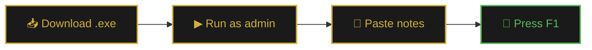
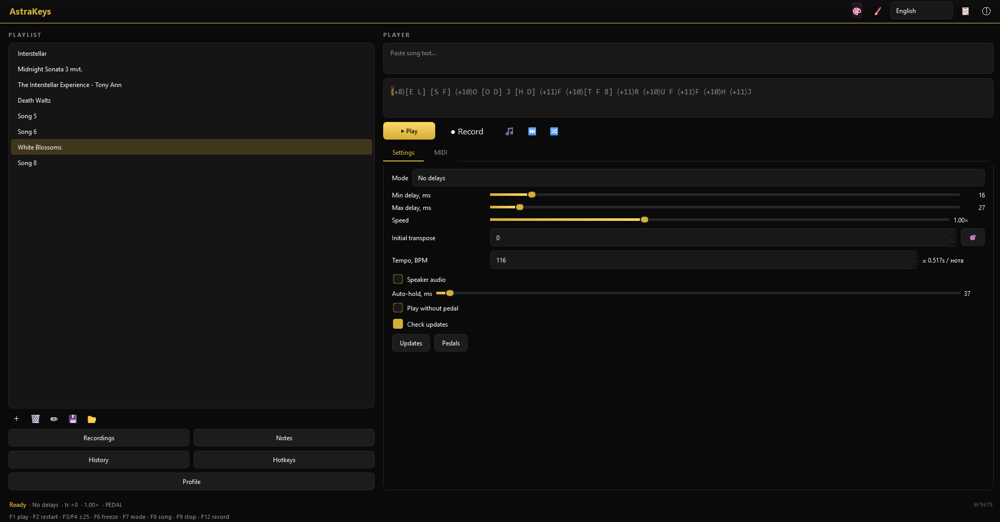
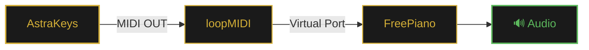

<div align="center">


<br>

**✨ Play · Record · Edit · Export ✨**

<sub>EN · [RU](README.ru.md) · [UK](README.uk.md)</sub>

<br><br>

<a href="https://github.com/SMisha2/AstraKeys/releases/latest">
  
</a>
<a href="#-quick-start">
  
</a>
<a href="#-demo">
  
</a>
<a href="https://github.com/SMisha2/AstraKeys/issues/new/choose">
  
</a>
<a href="https://github.com/SMisha2/AstraKeys/stargazers">
  
</a>

<br><br>

<sub>


</sub>

</div>

<br>

> [!IMPORTANT]
> **Before you download — read this:**
> - 🔒 **No injection, no telemetry.** AstraKeys только эмулирует нажатия клавиш и работает как обычный пользователь. Ничего не отправляется на серверы.
> - 🛡 **Antivirus false positive.** Сборка через PyInstaller — Windows Defender может ругаться. Инструкция в [FAQ](#-faq).
> - ⚠️ **Use at your own risk.** Автоматизация может нарушать ToS Roblox. Используй в соло-режимах и личных проектах. Подробнее — в [Disclaimer](#-disclaimer).

<br>

---

## 🎬 Demo

<div align="center">

<!-- TODO: заменить на реальный GIF/MP4 (10–15 сек, <10 МБ) -->


<sub><i>Paste notes → press F1 → Roblox plays</i></sub>

</div>

<br>

---

## 🆕 What's new in v1.3.0

- ⏱ **Timed format** — `{1441ms press}` для точного тайминга
- 🪟 **Notes overlay** — живые ноты поверх игры
- 🔄 **Auto-update** — обновления прямо из GitHub
- 🌍 **Localization RU / EN / UK**

→ Full history: [CHANGELOG.md](CHANGELOG.md)

<br>

---

## 🎯 What is AstraKeys

**AstraKeys** — это Windows-приложение, которое играет музыку в Roblox за тебя. Вставляешь ноты в формате Roblox piano — программа эмулирует нажатия с точным таймингом.

Но это не только плеер. Это **студия**:
- 🔴 Записывает твою игру
- ✂️ Позволяет редактировать записи
- 💾 Экспортирует в MIDI
- 🎹 Отправляет ноты во внешние синтезаторы через loopMIDI

<br>

---

## 🌟 Features

<table>
<tr>
<td width="50%" valign="top">

### 🎵 Playback
- 📜 Плейлист с drag & drop
- 🎹 Аккорды в Roblox-нотации
- 🎯 Два режима: **без задержек** / **с человеческими**
- 🎚️ Скорость **0.5× – 2.0×**
- 🎼 Поддержка **BPM** для авто-удержания

### 📝 Recording
- 🔴 Live-запись `F12`
- ✂️ Trim, concat, undo/redo
- 🎯 Квантизация `1/4` – `1/32`
- ⭐ Избранное, поиск, сортировка
- 📦 Import / export ZIP

</td>
<td width="50%" valign="top">

### 🎼 MIDI & Audio
- 🎹 MIDI out для FreePiano / loopMIDI
- 💾 Экспорт `.mid`
- 🔊 Встроенный синтезатор *(ADSR)*
- 🎹 Playback **без педали** *(auto-hold)*

### 🎨 Interface
- 🌗 **10 тем** + кастом
- 🌍 Локализация **RU / EN / UK**
- 🪟 Overlay поверх игры
- 📊 История прослушиваний
- 🔄 Авто-обновления

</td>
</tr>
</table>

<details>
<summary><b>📑 Full feature list</b></summary>

<br>

- 🎹 Точная эмуляция нажатий (`pynput`)
- 🎼 Timed format с абсолютными метками
- 🎚️ Volume control + выбор устройства вывода
- 🪟 Overlay: прозрачность, позиция, размер
- 📁 Профили песен (`song_profiles.json`)
- ⌨️ Кастомные хоткеи (`hotkeys.json`)
- 🗂 Бэкапы плейлиста
- 📊 Статистика: сколько сыграно, сколько записано

</details>

<br>

---

## ⚡ Quick Start



1. Открой [**Releases**](https://github.com/SMisha2/AstraKeys/releases/latest) → скачай `AstraKeys.exe`
2. Запусти **от имени администратора** (иначе Roblox не увидит нажатия)
3. Вставь ноты в поле ввода → открой Roblox Piano → нажми <kbd>F1</kbd>

> 💡 Первый запуск? Возьми готовый пример из [`examples/`](examples/).

<br>

### 💻 System requirements

| | |
|:---|:---|
| **OS** | Windows 10 / 11 (x64) |
| **Права** | Администратор |
| **Место на диске** | ~80 МБ |
| **Игра** | Roblox Piano или любая игра с раскладкой `1234567890 qwerty...` |

<br>

---

## 📸 Screenshots

<div align="center">

<table>
<tr>
<td align="center" width="50%">

<br><br>
<b>🎹 Main window</b>
<br>
<sub>Playlist, player, settings</sub>
</td>
<td align="center" width="50%">

<br><br>
<b>🎼 Notes overlay</b>
<br>
<sub>Live notes on top of the game</sub>
</td>
</tr>
<tr>
<td align="center" width="50%">

<br><br>
<b>✂️ Recording editor</b>
<br>
<sub>Trim, concat, quantize</sub>
</td>
<td align="center" width="50%">

<br><br>
<b>📚 Recordings manager</b>
<br>
<sub>Search, favorites, export</sub>
</td>
</tr>
</table>

</div>

<br>

---

## 🎮 Hotkeys

<div align="center">

| | | | |
|:---:|:---|:---:|:---|
| <kbd>F1</kbd> | ▶ Play / Pause | <kbd>F7</kbd> | 🔀 Switch mode |
| <kbd>F2</kbd> | 🔄 Restart song | <kbd>F8</kbd> | ⏭ Next song |
| <kbd>F3</kbd> | ⏩ +25 notes | <kbd>F9</kbd> | ⏹ Stop playback |
| <kbd>F4</kbd> | ⏪ −25 notes | <kbd>F10</kbd> | 🎵 Last recording |
| <kbd>F5</kbd> | ⏸ Pause recording | <kbd>F12</kbd> | 🔴 Start / stop recording |
| <kbd>F6</kbd> | ❄ Freeze position | <kbd>Ctrl</kbd>+<kbd>↑↓</kbd> | ⚡ Speed ± |

</div>

> 💡 **Pedal keys:** `-` `=` `[` `]` — удерживают ноту, пока зажаты.

<br>

---

## 🎼 Song format

Стандартная Roblox-нотация:

```text
[eT] [eT] [6eT] [ey] [6eT] [4qe] [qe] [6qe] [qE] 4 [6qe] 6 [QPS] C [Sc]
```

### 📖 Syntax

| Symbol | Meaning |
|:---:|:---|
| `q` | Нота — lowercase (белая клавиша) |
| `Q` | Нота — uppercase (чёрная клавиша) |
| `[qwe]` | Аккорд — ноты одновременно |
| `-` `=` `[` `]` | Педаль — удержание |
| _space_ | Игнорируется |

### 🎹 Key map

```text
1 2 3 4 5 6 7 8 9 0   →   C D E F G A B C D E
q w e r t y u i o p   →   F G A B C D E F G A
a s d f g h j k l     →   B C D E F G A B C
z x c v b n m         →   D E F G A B C
```

> 🔥 Uppercase и символы `!@#$%^&*()` — **диезы** (чёрные клавиши).

### ⏱ Timed format *(добавлено в v1.3.0)*

Формат с абсолютными метками времени для точного тайминга:

```text
C {1441ms release}   I   [Q I] {214842ms press}
```

| Part | Meaning |
|:---|:---|
| `{NNNms press}` | Нота **нажата** через N мс от начала |
| `{NNNms release}` | Нота **отпущена** через N мс от начала |
| _без `{}`_ | Интерполируется между ближайшими метками |

<br>

---

## 🎹 MIDI (FreePiano / loopMIDI)



1. Установи [**loopMIDI**](https://www.tobias-erichsen.de/software/loopmidi.html)
2. Создай виртуальный порт *(например `AstraKeys`)*
3. AstraKeys → вкладка **MIDI** → включи **MIDI output** → выбери порт → **Test**
4. В FreePiano выбери тот же порт как input

<br>

---

## ⚙️ How it works

```text
Roblox notation ──► parser ──► scheduler ──┬─► pynput        (клавиши в игру)
                                          ├─► mido + loopMIDI (MIDI out)
                                          └─► sounddevice    (локальный синтез)
```

- **UI** — PyQt6
- **Input emulation** — `pynput` (`keyboard._win32`)
- **MIDI** — `mido` + `python-rtmidi`
- **Audio** — `sounddevice` + `numpy` (ADSR-синтез)
- **Overlay** — `pywin32` (`win32gui` / `win32con`)

<br>

---

## 📁 Config files

Всё хранится рядом с приложением в JSON:

| 📄 File | 🗂 Contents |
|:---|:---|
| `app_settings.json` | Language, theme, MIDI, delays, speed, BPM |
| `playlist.json` | Сохранённый плейлист |
| `pedal_settings.json` | Символы педали |
| `recordings_index.json` | Индекс записей |
| `overlay_settings.json` | Настройки overlay |
| `window_state.json` | Позиция и размер окна |
| `hotkeys.json` | Кастомные хоткеи |
| `play_history.json` | История прослушиваний |
| `song_profiles.json` | Профили песен |
| `draft.txt` | Автосохранение поля ввода |
| `recordings/` | Записи `.json` + `.mid` |
| `backups/` | Бэкапы плейлиста |

<br>

---

## 🚀 Installation from source

```bash
# 1. Clone
git clone https://github.com/SMisha2/AstraKeys.git
cd AstraKeys

# 2. Install dependencies
pip install -r requirements.txt

# 3. Run
python AstraKeys.py
```

<details>
<summary><b>🛠️ Build .exe with PyInstaller</b></summary>

<br>

```bat
pip install pyinstaller

pyinstaller --noconfirm --clean --onefile --windowed ^
    --name "AstraKeys" ^
    --icon "assets/icon.ico" ^
    --hidden-import pynput.keyboard._win32 ^
    --hidden-import pynput.mouse._win32 ^
    --hidden-import sounddevice ^
    --hidden-import mido.backends.rtmidi ^
    --hidden-import win32gui ^
    --hidden-import win32con ^
    --collect-binaries sounddevice ^
    --collect-binaries rtmidi ^
    --collect-submodules pynput ^
    --collect-data midiutil ^
    AstraKeys.py
```

Результат: `dist/AstraKeys.exe`.

</details>

<br>

---

## ❓ FAQ

<details>
<summary><b>🛡 Antivirus deletes AstraKeys.exe</b></summary>
<br>

PyInstaller false positive. Добавь файл в исключения:

**Windows Defender → Virus & threat protection → Exclusions → Add file.**

Если всё равно не запускается — собери `.exe` сам (см. блок выше) или запусти из исходников.

</details>

<details>
<summary><b>⌨ Keys don't register in Roblox</b></summary>
<br>

Запусти AstraKeys **от имени администратора**. Roblox и AstraKeys должны иметь одинаковые привилегии.

</details>

<details>
<summary><b>🎹 MIDI port doesn't appear</b></summary>
<br>

Установи loopMIDI и создай порт **до** запуска AstraKeys. Затем нажми **⟳** на вкладке MIDI.

</details>

<details>
<summary><b>🔊 No audio from speakers</b></summary>
<br>

```bash
pip install sounddevice numpy
```

Затем включи **"Speaker audio"** на вкладке Parameters.

</details>

<details>
<summary><b>⏱ Recording timing is off</b></summary>
<br>

Открой **Editor → Trim** в менеджере записей. Также проверь режим:

- 🎯 **"No delays"** — детерминированный
- 🎲 **"With delays"** — рандомизированный

</details>

<details>
<summary><b>🎮 Can I use it with other games?</b></summary>
<br>

Да — любая игра, где ноты играются через `1234567890 qwerty...`. Убедись, что окно игры в фокусе.

</details>

<details>
<summary><b>🚫 Will I get banned in Roblox?</b></summary>
<br>

Автоматизация может нарушать ToS Roblox. **Используй на свой риск**, лучше в соло-режимах и личных проектах. AstraKeys не гарантирует безопасность аккаунта.

</details>

<br>

---

## 🗺 Roadmap

- [ ] Импорт MIDI в плейлист
- [ ] Пресеты раскладок (Garry's Mod, Terraria)
- [ ] CLI-режим
- [ ] Linux / macOS (через `xdotool` / `osascript`)
- [ ] Плагины для кастомных раскладок

Есть идея? [Открой issue](https://github.com/SMisha2/AstraKeys/issues/new/choose).

<br>

---

## ⚠️ Known Issues

- Обновления Roblox иногда ломают эмуляцию — следи за релизами.
- Windows Defender помечает `.exe` (PyInstaller FP) — добавляй в исключения.
- На ноутбуках с включённой фильтрацией клавиатуры (некоторые Logitech/HP) нажатия могут не доходить — отключи фильтр в драйвере.

<br>

---

## 🛠 Stack

<div align="center">

<p>


</p>

</div>

<br>

---

## 📊 Statistics

<div align="center">


<br><br>

<a href="https://star-history.com/#SMisha2/AstraKeys&Date">
  
</a>

</div>

<br>

---

## 🤝 Contributing

**Pull requests welcome!** 🎉
Для крупных изменений — сначала [открой issue](https://github.com/SMisha2/AstraKeys/issues/new/choose).

```bash
# Fork → Branch → PR
git checkout -b feature/amazing-feature
git commit -m "feat: add amazing feature"
git push origin feature/amazing-feature
```

Перед PR:
```bash
pip install -r requirements-dev.txt
ruff check .
pytest
```

Подробнее — в [CONTRIBUTING.md](CONTRIBUTING.md).

<br>

---

## ⚠️ Disclaimer

> AstraKeys — инструмент для обучения и развлечения.
> Автоматизация может нарушать условия использования Roblox и других игр.
> Автор **не несёт ответственности** за баны аккаунтов и любые другие последствия.
> Используй на свой риск — предпочтительно в соло-режимах и личных проектах.

<br>

---

## 📜 License

MIT — используй, форкай, меняй свободно.


<br>

---


<div align="center">

<sub>
<b>Author:</b> <a href="https://github.com/SMisha2">SMisha2</a>
&nbsp;·&nbsp;
<b>Version:</b> <code>1.3.0</code>
&nbsp;·&nbsp;
<b>Updated:</b> 2026
</sub>

<br><br>

<a href="https://github.com/SMisha2/AstraKeys/stargazers">
  
</a>

<br><br>

<sub>⬆ <a href="#top">Back to top</a></sub>

</div>
